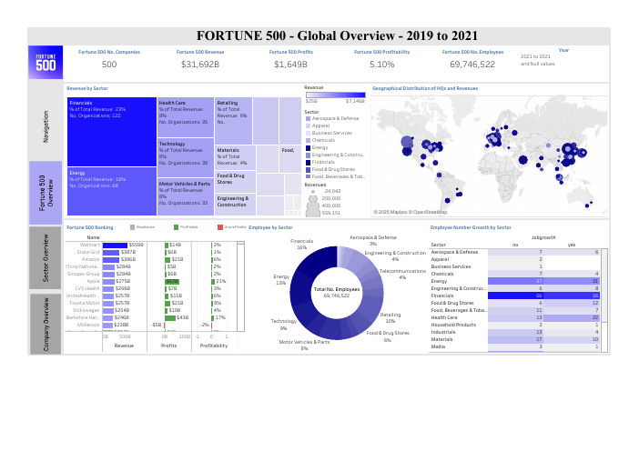
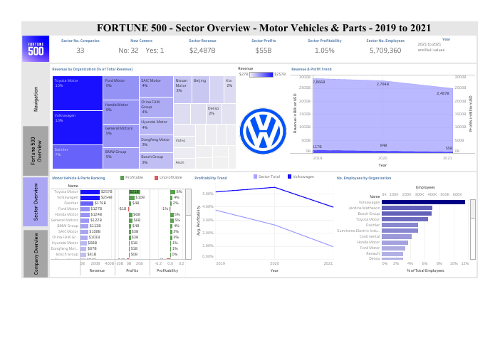
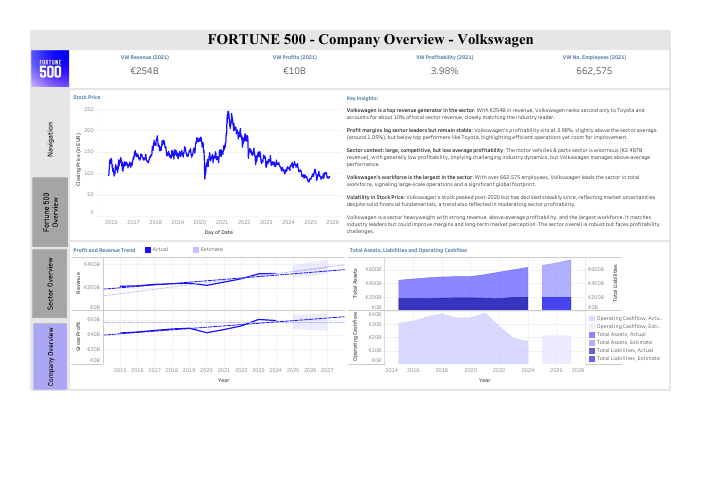

# Fortune Global 500 & Volkswagen: Tableau Dashboards

An interactive Tableau story that goes from the **Fortune Global 500 (2019–2021)** down to one company: **Volkswagen**. It covers revenue, profit and headcount across sectors and countries, then a 10-year view of VW's fundamentals and share price, and ends with a strategic roadmap for the company.

`Tableau Desktop` · `Tableau Prep` · `Python (data pull)` · `Data storytelling`

<p>



</p>

## Dashboards

1. **Fortune 500 Overview:** 500 companies, $31.7T revenue, $1.6T profit, 5.1% average margin and about 70M employees. Includes a world map of headquarters and revenue, rankings and newcomers.
2. **Sector Overview:** treemap, revenue/profit/profitability and headcount growth by sector, plus market share.
3. **Company Overview (Volkswagen):** position in the Motor Vehicles & Parts ranking, revenue and profit trends, profitability, employees, total assets vs liabilities, operating cash flow and 10-year share price (VOW3.DE).
4. **Fortune 500 Story:** the guided narrative that links the three.

## Repository layout

```
workbook/fortune500_volkswagen.twb   Tableau workbook
prep/                                Tableau Prep flow (de-duplicating HQ city locations)
data/                                Fortune Global 500 2019–2021 + VW financial statements (annual & quarterly), dividends, 10-year prices
reports/Dashboard_Export.pdf         static export of the dashboards
reports/Strategic Roadmap Volkswagen.docx
```

## Opening the workbook

Open `workbook/fortune500_volkswagen.twb` in Tableau Desktop or Tableau Public. If Tableau asks for missing data sources, point it at the matching files in `data/`.

**Tip:** publish the workbook to [Tableau Public](https://public.tableau.com) and link it here so recruiters can explore it without installing anything.

## Context

Individual assignment for a Data Visualization course, Master in Business Analytics & Data Science, IE University.
